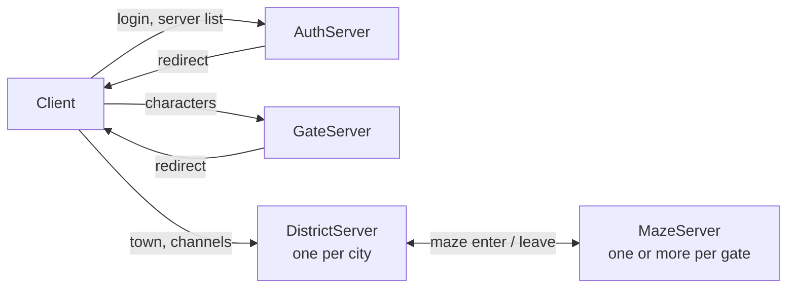
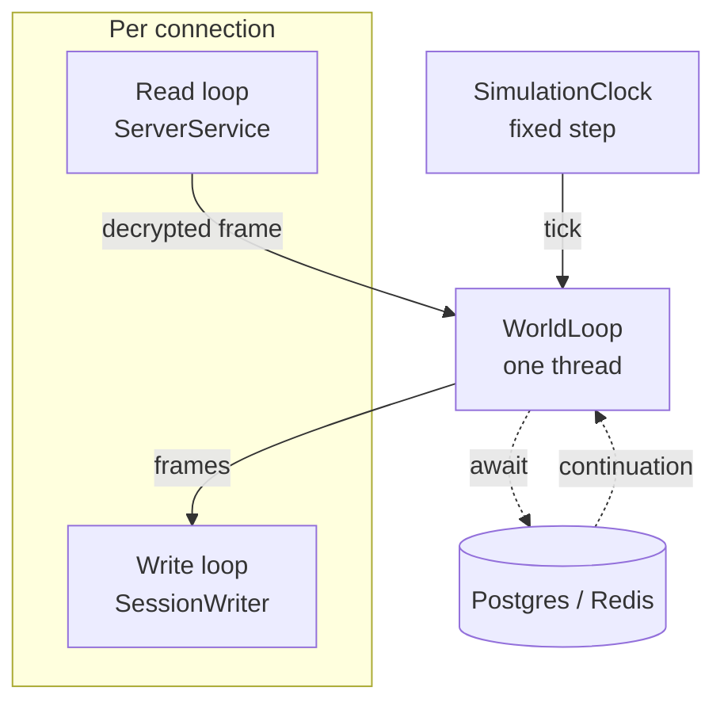

# OpenWorker architecture

How the servers are split, where game state lives, and the rules code on the world loop has to follow.
It describes the code as it is; when the code changes the rules, change this file with it.

## Processes

Each hop of the client is its own TCP endpoint and its own process. Changing hop means a new
connection: a session never turns into another role in place.

| Process | Owns |
|---|---|
| AuthServer | Accounts, login, the list of gates |
| GateServer | Character list, creation, deletion, selection |
| DistrictServer | One city with its channels (`Channel__From`..`Channel__To`) |
| MazeServer | Maze instances: monsters, combat, AI scripts |
| RelayServer | Discord bot, Redis index setup (it drops the cache on start) |
| UpdateContent | Loads the client tables into the database |

Shared state between processes:

- **Postgres** is the source of truth for everything that survives a logout.
- **Redis** holds what is valid only while servers run: session leases, the servers of each gate
  (`DistrictCache`, `MazeCache`, `ChannelCache`) and the reservations that carry a player from one
  server to the next (`DistrictReserveCache`, `MazeReserveCache`). Records that describe a server
  expire unless the server renews them.
- **Redis pub/sub** (`CommunityNetwork`) carries notifications between servers: friends, leagues,
  whispers. Delivery is at most once, so a message is a hint to refresh, never the only copy of a change.

### Moving between servers

The server that sends a player away writes a reservation to Redis with a short lifetime
(`WorldManager.ReservationLifetime`) and answers the client with the address. The destination accepts
the connection only if it finds the reservation, and the session lease follows the player.

Every way into a server writes a reservation before the client is given the address: the gate when a
character is selected, a portal or a warp of a district, the exit of a maze. A district and a maze both
close a connection that has no reservation, one that has expired, or one that was written for another
person or another server (a reservation that belongs to someone else is left in place). There is no
default spawn point: the place of the player is the place the reservation carries. The price is that a
client that takes longer than `ReservationLifetime` to connect is turned away and has to start again
from the gate.

Maze servers register themselves in `MazeCache` with their player count (`MazeRegistrationService`);
a player entering a maze goes to the server of the gate with the fewest players. With none registered,
`Maze:Host` / `Maze:Port` are used. More maze servers are more capacity, nothing else changes.

## Inside one process

- **Read loop.** One task per connection reads a frame, decrypts it and hands it to the world loop.
  It waits for the handler to finish before it reads the next frame, so the packets of one
  connection are handled one after another, in order.
- **Write loop.** `SessionWriter` sends the frames of one connection on its own task, from a queue
  of at most 4096 frames. A client that falls that far behind is disconnected; it slows nobody else.
- **World loop.** `WorldLoop` is a `SynchronizationContext` with one thread. Every packet handler,
  every timer and the closing of every connection runs there, one at a time, so the ECS world and the
  managers need no locks.
- **Simulation clock.** `SimulationClock` steps everything that lives in game time (the monsters of
  every maze) together, every 50 ms, on the world loop. A step longer than the period is reported,
  and after a stall the clock skips ticks and caps the step, so the game slows down instead of jumping.
- **ECS.** Arch holds sessions, persons and creatures as components. Arch keeps one static registry
  of component types for the whole process and it is not thread safe: touch it from the world loop only,
  and keep tests that create entities out of parallel runs.

## Rules for code on the world loop

1. **No `ConfigureAwait(false)`.** The continuation must come back to the world loop.
   Slow synchronous work (hashing, file parsing) goes through `Task.Run`, then comes back by `await`.
2. **Every `await` is a door.** While a handler waits for the database or Redis, other connections and
   timers run on the loop. After an `await`:
   - check that the entity is still alive (`world.IsAlive`) before touching it;
   - read components again instead of using values read before the `await`;
   - do not trust a check made before the `await` (enough gold, name free, slot empty).
3. **Uniqueness and limits belong to the database.** A check in memory or a query before an insert
   cannot stop two servers doing the same thing at the same moment. Put a unique index or a constraint
   in the model, keep the check for the friendly answer, and treat the unique violation
   (`PostgresErrorCodes.UniqueViolation`) as the same answer. Examples: league names, character names,
   account names, one league per person.
4. **Changes that span rows run in one transaction** in the store (`LeagueStore`, `FriendStore`).
5. **No blocking calls** (`.Result`, `.Wait()`, `WorldLoop.Send`): the loop would wait for itself.

## Database

Every server migrates the database before its other services start (`PersistenceBootstrapService`);
Npgsql locks the database while it migrates, so servers that start together apply each migration once.
EF Core refuses to migrate while the model has changes with no migration: after changing the model,
add the migration before starting the servers.

Connection settings: `ConnectionStrings:Postgres`, `ConnectionStrings:Redis` (see Settings).

## Settings

Each server project carries an `appsettings.json` with the defaults that match `compose.yaml`; an environment
variable named like the setting, with `__` for `:` (`Instance__PublicPort`), replaces one. Code reads settings as
options (`IOptions<T>`, the classes in `OpenWorker.Extensions/Options`) and carries no default for an address,
a port or a connection string. The options are validated when the host starts, before the first service: a missing
or wrong setting stops the server with a message that names the key. A setting with no sensible default
(`Instance:Location` and `Instance:PublicPort` of a district: every district has its own) is required.

- `ConnectionStrings:Redis` is an address like `redis://redis:6379`. One setting serves the cache (Redis.OM) and
  the notifications between servers (StackExchange.Redis, built by `RedisOptions.ToConfigurationOptions`).
- To add a setting: add the options class with its attributes and a partial `[OptionsValidator]` class, register it
  in `OptionsServiceCollectionExtensions`, put the default in the `appsettings.json` of the servers that need it, and
  add the server to `TestServerOptions`.

## Known limits

- **One thread per process.** A busy maze server is the first to hit it; the answer is more maze
  servers, not more threads in one. The clock logs when steps run over budget.
- **Writes wait on the loop.** Handlers save as they go. Moving saves to a write-behind queue, where the
  handler changes memory and the save happens later, would remove most of the `await` doors of rule 2.
  Not done yet.
- **The relay wipes Redis on start.** Restarting it while other servers run drops their sessions;
  maze servers re-register within `MazeRegistrationService.RenewInterval`, districts do not.
