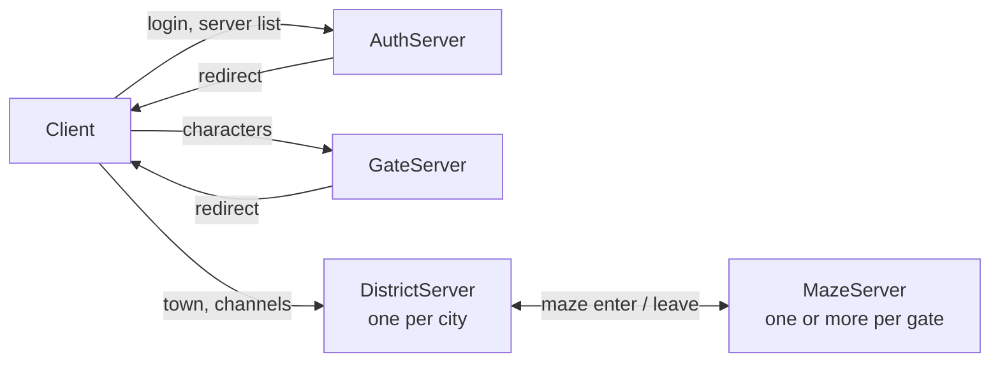
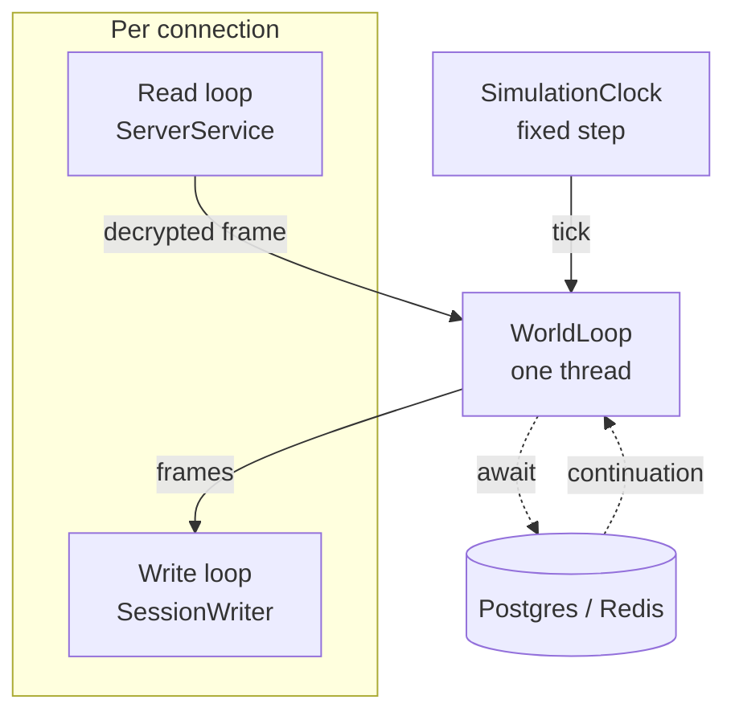

# OpenWorker architecture

How the servers are split, where game state lives, and the rules code on the world loop has to follow.
It describes the code as it is; when the code changes the rules, change this file with it.

## Processes

Each hop of the client is its own TCP endpoint and its own process. Changing hop means a new
connection: a session never turns into another role in place.

| Process | Owns |
|---|---|
| AuthServer | Accounts, login, the list of gates |
| GateServer | Character list, creation, deletion, selection |
| DistrictServer | One city with its channels (`Channel__From`..`Channel__To`) |
| MazeServer | Maze instances: monsters, combat, AI scripts |
| RelayServer | Discord bot, Redis index setup (it drops the cache on start) |
| UpdateContent | Loads the client tables into the database |

Shared state between processes:

- **Postgres** is the source of truth for everything that survives a logout.
- **Redis** holds what is valid only while servers run: session leases, the servers of each gate
  (`GateCache`, `DistrictCache`, `MazeCache`, `ChannelCache`) and the reservations that carry a player from one
  server to the next (`DistrictReserveCache`, `MazeReserveCache`). A server that stops in order takes its own
  records back (see Stopping a server); a maze record also expires unless its server renews it, the others do not.
- **Redis pub/sub** (`CommunityNetwork`) carries notifications between servers: friends, leagues,
  whispers. Delivery is at most once, so a message is a hint to refresh, never the only copy of a change.

### Moving between servers

The server that sends a player away writes a reservation to Redis with a short lifetime
(`WorldManager.ReservationLifetime`) and answers the client with the address. The destination accepts
the connection only if it finds the reservation, and the session lease follows the player.

Every way into a server writes a reservation before the client is given the address: the gate when a
character is selected, a portal or a warp of a district, the exit of a maze. A district and a maze both
close a connection that has no reservation, one that has expired, or one that was written for another
person or another server (a reservation that belongs to someone else is left in place). There is no
default spawn point: the place of the player is the place the reservation carries. The price is that a
client that takes longer than `ReservationLifetime` to connect is turned away and has to start again
from the gate.

Maze servers register themselves in `MazeCache` with their player count (`MazeRegistrationService`);
a player entering a maze goes to the server of the gate with the fewest players. With none registered,
`Maze:Host` / `Maze:Port` are used. More maze servers are more capacity, nothing else changes.

## Inside one process

- **Read loop.** One task per connection reads a frame, decrypts it and hands it to the world loop.
  It waits for the handler to finish before it reads the next frame, so the packets of one
  connection are handled one after another, in order.
- **Write loop.** `SessionWriter` sends the frames of one connection on its own task, from a queue
  of at most 4096 frames. A client that falls that far behind is disconnected; it slows nobody else.
- **World loop.** `WorldLoop` is a `SynchronizationContext` with one thread. Every packet handler,
  every timer and the closing of every connection runs there, one at a time, so the ECS world and the
  managers need no locks.
- **Simulation clock.** `SimulationClock` steps everything that lives in game time (the monsters of
  every maze) together, every 50 ms, on the world loop. A step longer than the period is reported,
  and after a stall the clock skips ticks and caps the step, so the game slows down instead of jumping.
- **ECS.** Arch holds sessions, persons and creatures as components. Arch keeps one static registry
  of component types for the whole process and it is not thread safe: touch it from the world loop only,
  and keep tests that create entities out of parallel runs.

### Health

Auth, gate, district, maze and the relay serve two URLs over HTTP on `Health:Port` (8080 inside the
container; `compose.yaml` does not publish it), a port apart from the one players use. Kestrel is the only part of
ASP.NET Core in the process (`UseHealthEndpoint`, called first on the host builder of each `Program.cs`), so the
images are `dotnet/aspnet` and the build and the tests need the ASP.NET Core runtime and targeting pack (the SDK
installers carry them; distribution packages split them off).

- `/healthz` is liveness: the world loop runs an empty callback within `Health:LoopTimeout`. A failure means restart.
- `/readyz` is readiness: liveness, a Redis `PING` and a database `CanConnect` (each within `Health:CheckTimeout`), the
  game listener is up, and the server is not draining. A failure means send no players; it does not mean restart.

The checks run on the thread pool, never on the loop: the loop only sees the empty callback, and a stuck loop keeps
one pending callback instead of collecting one per probe. The module that owns a dependency registers its check
(`AddCache` Redis, `AddPersistence` Postgres, `AddHotspot` loop and listener), so the relay, which has no world loop,
reports Redis and the database only. Compose probes `/readyz` with `curl`, which the image installs; the body names
the check that fails.

### Stopping a server

`ServerShutdownService` is a lifecycle service: the host calls its `StoppingAsync` before it stops any
service, so the order below does not depend on the order of registration. The signal to stop (SIGTERM) already turns
readiness off, because `ServerState` listens to `ApplicationStopping`.

1. `ServerService.StopAcceptingAsync` closes the listener; new connections are refused.
2. Every `IServerRegistration` withdraws: the loop that renews a record ends, then the record goes (maze, district,
   channels, gate; the lease renewal only stops). New players are no longer sent here. A service that keeps a record
   derives from `RegistrationService` (registered with `AddRegistrationService`), which does this once, whether the
   drain or the host asks first. The withdrawal runs next to step 3 and is awaited after it.
3. `ServerService.CloseSessionsAsync` stops the read loops (a packet that is being handled is finished) and every
   session closes through the normal path: the client gets a kick-out with the reason `GmToolServerShutdown`, the
   `ISessionCloseHandler`s run on the world loop (they save what the player changed and release the lease), the
   writer sends what is queued, and the connection closes. `shuttingDown` in `ServerService.SessionLoopAsync` and
   `CloseSessionAsync` marks a close caused by the shutdown, and `sessions.closed` counts it under the reason `shutdown`.
4. The host stops the other services, the health endpoint among them; last the container disposes the world loop.
   The loop runs through the whole drain, because the close handlers need it.

`Shutdown:DrainTimeout` (15 s) bounds steps 1 to 3 as a whole and the wait for each writer: a client that does not
read is cut off, and sessions that are left are logged. `Shutdown:Timeout` (30 s) is the time of the host
(`HostOptions.ShutdownTimeout`) and must be longer; compose gives the container 40 s before it kills it.

### Metrics

Every server records its numbers on one `Meter` named `OpenWorker` (`OpenWorkerMeter.Name`), plus the `System.Runtime` meter of
.NET (GC, thread pool, process: `dotnet.gc.*`, `dotnet.thread_pool.*`). A process with `Telemetry:Endpoint` set pushes both over OTLP to
Prometheus (`AddTelemetry`, called by `AddHotspot`; the relay calls it itself); with no endpoint nothing is exported and the
instruments stay switched off. The compose file starts Prometheus and Grafana, and the dashboard `OpenWorker` is provisioned from
`eng/observability` (how to open it: the notes at the end of `compose.yaml`).

The meters come from the `IMeterFactory` of the container, and each area has a small class that creates its instruments on it:
`WorldLoopMetrics`, `HandlerMetrics`, `SimulationMetrics`, `SessionMetrics`, `RedisMetrics` and `PostgresMetrics` in
`OpenWorker.Hotspot/Telemetry`, all registered by `AddOpenWorkerMetrics`. A test makes its own container and listens with
`MetricCollector<T>` (`MetricsHost` in `OpenWorker.Hotspot.Test`), so it sees only its own measurements. The classes that measure take
the metrics class as the last, optional constructor parameter: `null` is a part nobody measures, as in most tests.

| Instrument | Kind, unit | Tags | Measured |
|---|---|---|---|
| `worldloop.queue.length` | gauge, callbacks | | callbacks posted to the loop that have not started |
| `worldloop.callback.duration` | histogram, s | | how long one callback holds the loop thread |
| `handler.duration` | histogram, s | `opcode` | the task of a handler, from start to end, awaits included |
| `handler.errors` | counter | `reason`: `malformed`, `handler_fault` | packets that failed to parse or to handle |
| `simulation.step.duration` | histogram, s | | one tick of `SimulationClock`, all simulations |
| `simulation.count` | gauge, simulations | | simulations (mazes) the clock steps |
| `simulation.overbudget` | counter | | ticks longer than the 50 ms period |
| `sessions.active` | up-down counter | | open connections |
| `sessions.closed` | counter | `reason`: `client`, `server`, `backpressure`, `timeout`, `malformed`, `shutdown` | connections that ended, once each |
| `writer.queue.length` | up-down counter, frames | | frames queued in the `SessionWriter`s of the process |
| `frames.sent`, `bytes.sent`, `bytes.received` | counters | | frames written to sockets and bytes on the wire, headers included |
| `redis.call.duration` | histogram, s | `operation`: the Redis command | a command, from the moment it is made to its answer |
| `postgres.call.duration` | histogram, s | `operation`: `SELECT`, `INSERT`, `UPDATE`, `DELETE`, `OTHER` | a command, until the database starts to answer |

Prometheus renames them on the way in: `sessions.closed` is `sessions_closed_total`, `handler.duration` is `handler_duration_seconds_bucket`.

- **Why a connection closed.** `SessionWriter` ends once per connection and counts it there; the first `SessionCloseReason` given to the
  writer is the one reported. `ServerSessionComponent.Disconnect(reason)` is how code gives one (`Timeout` in the keep-alive of a district,
  `Malformed` in `HandlerExecutor` when the error budget runs out; `Disconnect()` alone is `Server`). The writer gives `Backpressure` for a
  full queue or a write that times out, and `Client` for a socket that fails; the read loop in `ServerService` gives `Client` for the end
  of the stream and `Shutdown` for a session the drain closes. The drain names `Shutdown` with `SetCloseReason` before the close
  handlers queue the kick-out, so a client that cannot take its last frames, or is cut off at the end of the drain, is still
  counted once and as `shutdown`. To add a reason: add it to `SessionCloseReason` and give it a name in `SessionMetrics.Tag` (a
  test fails if a reason has no name of its own).
- **Redis** is measured on the connection, not around the calls: the process has one `IConnectionMultiplexer` (`AddRedisConnection`),
  used by Redis.OM and by the code that calls StackExchange.Redis, and the profiler of that connection reports every command with the time
  the multiplexer measured. The `PING` of the readiness check goes over that connection too and shows up as the operation `PING`.
  `RedisMetricsService` turns what it collected into measurements once a second, and while nobody listens the profiler collects
  nothing. **Postgres** is measured by `PostgresCommandInterceptor`, an interceptor of EF Core registered in
  `AddPersistence`, which takes the duration EF Core already measures.
- **Cost on the hot path.** Recording must cost nothing noticeable while nobody listens and allocate nothing while somebody does:
  `Stopwatch.GetTimestamp()` for times, taken only when the instrument is `Enabled`; tags are `KeyValuePair` values of strings made once
  (the name of an opcode is built when the handler table is, not per packet); no LINQ, no closure, no `string.Format` on the way.
- **Names in Prometheus.** The `System.Runtime` metrics arrive as `dotnet_gc_pause_time_seconds_total`,
  `dotnet_gc_collections_total{gc_heap_generation}`, `dotnet_gc_heap_allocated_bytes_total`,
  `dotnet_thread_pool_queue_length_total`, `dotnet_process_cpu_time_seconds_total`, and so on; `bytes.sent` is `bytes_sent_total`.
  The service is the label `job` (the name of its executable) and the process the label `instance` (its identifier); the location
  of a district and the gate are `openworker_location` and `openworker_gate` (`eng/observability/prometheus/prometheus.yml`).
- **GC and JIT settings** of the servers are written out in `Directory.Build.props` with the values .NET uses anyway; which values to
  run with is decided by measurements (phase 1, step 7), and `ServerGarbageCollection` is the property that flips them.
- **To add an instrument:** create it in the metrics class of its area with the unit, a description and (for a duration)
  `CreateDuration`, which sets bucket edges in seconds; record it from the code that owns the thing; add a `MetricCollector` test next to
  the tests of that code; add the row to the table above and a panel to `eng/observability/grafana/dashboards/openworker.json`.

## Rules for code on the world loop

1. **No `ConfigureAwait(false)`.** The continuation must come back to the world loop.
   Slow synchronous work (hashing, file parsing) goes through `Task.Run`, then comes back by `await`.
2. **Every `await` is a door.** While a handler waits for the database or Redis, other connections and
   timers run on the loop. After an `await`:
   - check that the entity is still alive (`world.IsAlive`) before touching it;
   - read components again instead of using values read before the `await`;
   - do not trust a check made before the `await` (enough gold, name free, slot empty).
3. **Uniqueness and limits belong to the database.** A check in memory or a query before an insert
   cannot stop two servers doing the same thing at the same moment. Put a unique index or a constraint
   in the model, keep the check for the friendly answer, and treat the unique violation
   (`PostgresErrorCodes.UniqueViolation`) as the same answer. Examples: league names, character names,
   account names, one league per person.
4. **Changes that span rows run in one transaction** in the store (`LeagueStore`, `FriendStore`).
5. **No blocking calls** (`.Result`, `.Wait()`, `WorldLoop.Send`): the loop would wait for itself.

## Rules for the rest of the code

1. **Background services look the same.** `protected override async Task ExecuteAsync` with a `PeriodicTimer`
   (built on the injected `TimeProvider` where a test drives it); one failed round is logged and the next one
   runs; cancellation on stop ends the loop quietly. `Task.Factory.StartNew` with an async lambda is forbidden:
   it returns a `Task<Task>` whose failure nobody sees. A one-shot start-up service may throw: a server that
   cannot start must not run.
2. **`Debug.Assert` only for invariants of our own code.** Anything that comes from Redis, the database, the
   settings, the batch files or the client is checked in Release and answered (a failure response to the client,
   a refused start of the server), with a log line.
3. **Data of the client is hostile.** A length or an index is checked before it is used; a packet that fails to
   parse or a handler that throws counts against the error budget of the session (`HandlerErrorBudget`,
   `Hotspot:ErrorBudget`), which closes the connection when it runs out. That is a `Warning`; `Critical` is for the
   state of the process. A handler that needs a component the client may not have yet (`LuaMaze`, a reservation)
   checks for it with `Has`/`TryGet` and ignores or refuses the request.
4. **Logs are structured.** Message templates through `[LoggerMessage]` methods, never string interpolation and
   never `Console`.
5. **Data is parsed and formatted with `CultureInfo.InvariantCulture`.** A server under a culture with a decimal
   comma reads `1.5` from a batch file otherwise.

The build enforces part of this: `Directory.Build.props` turns on the analyzers (`latest-recommended`), the
projects `Hotspot`, `Channel`, `Gameplay`, `Persistence` and `Navigation` treat warnings as errors, and
`eng/check-forbidden.sh` (run by CI) fails on `Task.Factory.StartNew` and `Console` in product code. Path-scoped
exceptions, such as the names of client enums, live in `.editorconfig` with the reason next to them.

## Database

Every server migrates the database before its other services start (`PersistenceBootstrapService`);
Npgsql locks the database while it migrates, so servers that start together apply each migration once.
EF Core refuses to migrate while the model has changes with no migration: after changing the model,
add the migration before starting the servers. Two branches that each add a migration from the same
snapshot produce two migrations that repeat each other, and the second one fails on an empty database
while `has-pending-model-changes` stays quiet; after merging such branches, apply the whole chain to an
empty database (`dotnet ef database update`, as CI does) before pushing.

Nothing reads the database while the container is built: the host builds every hosted service before it starts the
first, so such a read would come before the migration. What a server needs from the database at start is read by a
hosted service that starts after the migration (`ServerContentLoadService` fills `ServerContent` before the listener
starts); a table that is still missing then stops the server.

Connection settings: `ConnectionStrings:Postgres`, `ConnectionStrings:Redis` (see Settings).

## Settings

Each server project carries an `appsettings.json` with the defaults that match `compose.yaml`; an environment
variable named like the setting, with `__` for `:` (`Instance__PublicPort`), replaces one. Code reads settings as
options (`IOptions<T>`, the classes in `OpenWorker.Extensions/Options`) and carries no default for an address,
a port or a connection string. The options are validated when the host starts, before the first service: a missing
or wrong setting stops the server with a message that names the key. A setting with no sensible default
(`Instance:Location` and `Instance:PublicPort` of a district: every district has its own) is required.

- `ConnectionStrings:Redis` is an address like `redis://redis:6379`. One setting, and one connection of the process
  (`AddRedisConnection`), serves the cache (Redis.OM) and the notifications between servers (StackExchange.Redis, built
  by `RedisOptions.ToConfigurationOptions`).
- `Hotspot:ErrorBudget:MaxErrors` and `Hotspot:ErrorBudget:Window` (`00:01:00` is a minute) say how many packets of one
  session may fail to parse or to handle before the server closes its connection; `HandlerErrorBudget` reads them.
- `Health:Port`, `Health:LoopTimeout` and `Health:CheckTimeout` (`00:00:05` is five seconds) say where the health endpoint
  listens and how long its checks wait; `Health:Port` must differ from `Server:Port`.
- `Shutdown:Timeout` and `Shutdown:DrainTimeout` say how long the host and the drain of a stopping server may take;
  the timeout must be the longer.
- `Telemetry:Endpoint`, `Telemetry:Protocol` and `Telemetry:ExportInterval` (at least `00:00:01`) say where and how often
  the metrics are sent (see "Metrics" under "Inside one process"). An empty endpoint (`Telemetry__Endpoint=`) turns the
  export off; the metrics are still recorded in the process.
- `Credentials:DiscordToken` of the relay is a secret: no file carries it, it comes from the environment
  (`Credentials__DiscordToken`), and the relay stops at start without it.
- `PersonCreation:StartLevel` of the gate is the level a new character starts at, 1 unless set (1 to 100).
- `Rewards:ExpRate` and `Rewards:DropRate` of the district and the maze multiply the experience of a kill and the
  chances of a drop; 1 unless set, never negative.
- `Attendance:ResetHour` and `DailyMission:ResetHour` are optional (the hour the game day starts at); the rules of the
  feature decide when they are not set.
- To add a setting: add the options class with its attributes and a partial `[OptionsValidator]` class, register it
  in `OptionsServiceCollectionExtensions`, put the default in the `appsettings.json` of the servers that need it, and
  add the server to `TestServerOptions`.

## Known limits

- **One thread per process.** A busy maze server is the first to hit it; the answer is more maze
  servers, not more threads in one. The clock logs when steps run over budget.
- **Writes wait on the loop.** Handlers save as they go. Moving saves to a write-behind queue, where the
  handler changes memory and the save happens later, would remove most of the `await` doors of rule 2.
  Not done yet.
- **The relay wipes Redis on start.** Restarting it while other servers run drops their sessions;
  maze servers re-register within `MazeRegistrationService.RenewInterval`, districts do not.
- **A crash leaves the records of a server behind.** Only an orderly stop takes them back. The gate, district
  and channel records have no lifetime in Redis and stay after a `kill -9` until the relay clears Redis.
- **The shutdown notice is untried.** What the client shows for a kick-out with `GmToolServerShutdown` on a district
  or a maze is not known; `ServerService.NotifyShuttingDown` is where it would change. A close with unread data from
  the client can end in a reset rather than a FIN; a half-close would remove that doubt.
