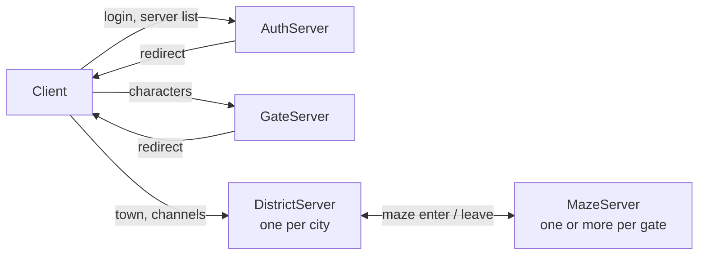
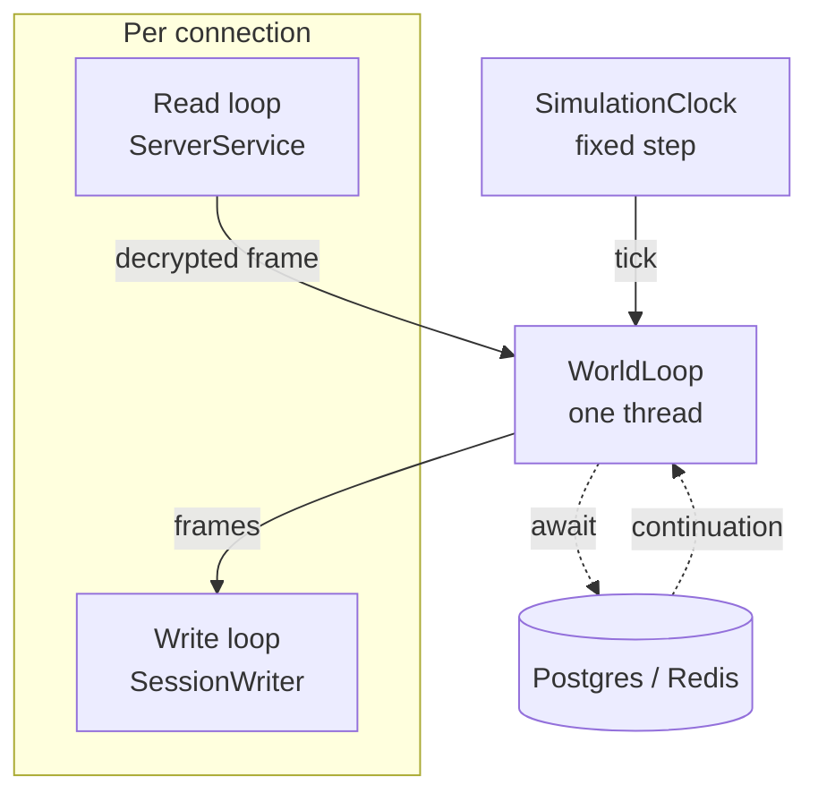

# OpenWorker architecture

How the servers are split, where game state lives, and the rules code on the world loop has to follow.
It describes the code as it is; when the code changes the rules, change this file with it.

## Processes

Each hop of the client is its own TCP endpoint and its own process. Changing hop means a new
connection: a session never turns into another role in place.

| Process | Owns |
|---|---|
| AuthServer | Accounts, login, the list of gates |
| GateServer | Character list, creation, deletion, selection |
| DistrictServer | One city with its channels (`Channel__From`..`Channel__To`) |
| MazeServer | Maze instances: monsters, combat, AI scripts |
| RelayServer | Discord bot, Redis index setup (it makes the missing indexes and never deletes a record) |
| UpdateContent | Loads the client tables into the database |

Shared state between processes:

- **Postgres** is the source of truth for everything that survives a logout.
- **Redis** holds what is valid only while servers run: session leases, the servers of each gate
  (`GateCache`, `DistrictCache`, `MazeCache`, `ChannelCache`) and the reservations that carry a player from one
  server to the next (`DistrictReserveCache`, `MazeReserveCache`). A server that stops in order takes its own
  records back (see Stopping a server); every record of a server (gate, district, channel, maze) also expires unless its
  server renews it, so the records of a server that crashed go by themselves within half a minute.
- **Redis pub/sub** (`CommunityNetwork`) carries notifications between servers: friends, leagues,
  whispers. Delivery is at most once, so a message is a hint to refresh, never the only copy of a change.

### Moving between servers

The server that sends a player away writes a reservation to Redis with a short lifetime
(`WorldManager.ReservationLifetime`) and answers the client with the address. The destination accepts
the connection only if it finds the reservation, and the session lease follows the player.

Every way into a server writes a reservation before the client is given the address: the gate when a
character is selected, a portal or a warp of a district, the exit of a maze. Before it writes the reservation, a district
or a maze writes what the player changed (`IPersonFlush`, see Database), so the next server loads it from the database;
going back to the gate or the server list does the same. A district and a maze both
close a connection that has no reservation, one that has expired, or one that was written for another
person or another server (a reservation that belongs to someone else is left in place). There is no
default spawn point: the place of the player is the place the reservation carries. The price is that a
client that takes longer than `ReservationLifetime` to connect is turned away and has to start again
from the gate.

Maze servers register themselves in `MazeCache` with their player count (`MazeRegistrationService`), and in a sorted
set of the gate by players (`MazeDirectory`, `ow:mazes:<gate>`); a player entering a maze goes to the server of the gate
with the fewest players, picked by one script that skips (and drops) a server whose record has expired. With none registered,
`Maze:Host` / `Maze:Port` are used. More maze servers are more capacity, nothing else changes.

### Projects and their layers

The code of a server is cut into layers that point one way: a project references its own layer and the layers below it,
never above, and `ProjectLayersTest` (`OpenWorker.Hotspot.Test`) reads the project files and fails on a reference that goes
up or on a project that has no layer. From the bottom:

| Layer | Projects | What it is |
|---|---|---|
| Foundation | `Wire`, `Wire.SourceGenerators`, `Commands.SourceGenerators`, `Navigation`, `Havok` | the span reader and writer, the generators, the navigation meshes |
| Domain | `Domain` | value types, entities of the database, store interfaces (`OpenWorker.Domain.Stores`); no EF Core, no Redis |
| Shared data | `Extensions`, `Res`, `Batch`, `SourceGenerator.ResourceStructures` | settings, readers of the client tables and the map files |
| Protocol | `Protocol` | opcodes, messages (`Modules/<Group>`), header, encryption, `Frame`, `FrameEncoder` |
| Runtime | `Runtime` | `WorldLoop`, `SimulationClock`, sessions and `SessionWriter`, the handler table and `HandlerExecutor`, error budget, rate limits, metrics, log scope |
| Infrastructure | `Infrastructure.Redis`, `Persistence` | Redis (records, leases, `MazeDirectory`, index bootstrap) and Postgres (model, stores, migrations) |
| Game logic | `Gameplay`, `Lua`, `AuthServer.Gameplay`, `DistrictServer.Gameplay` | rules of the game, maze scripts, the handlers of auth and district |
| Channel | `Channel`, `GateServer.Gameplay`, `Commands`, `Server.Common` | services shared by district and maze: channels, chat, community; the handlers both run (`Server.Common`) |
| Hosting | `DependencyInjection` | the host of a server: `ServerService`, health, shutdown, telemetry |
| Servers | `AuthServer`, `GateServer`, `DistrictServer`, `MazeServer`, `RelayServer`, `UpdateContent`, `LoadTest` | the processes |

Through every project it references, `Protocol` reaches neither EF Core, Redis nor `Batch`, `Runtime` neither EF Core nor Redis,
and `Gameplay`, `Lua` and `DistrictServer.Gameplay` no EF Core: the game reads and writes a person through `IPersonStore`, which
`Persistence` implements. `AuthServer.Gameplay` and `GateServer.Gameplay` still query the database in their handlers. The namespaces
of the code that came out of `OpenWorker.Hotspot` did not change (`OpenWorker.Hotspot.*`): Redis.OM names the keys of a record after
the full name of its type. `ServerService` stays in `DependencyInjection`: it builds the entity of a connection
(`ArchComponentProvider`), reads the claims of `Gameplay` and kicks the players out at shutdown, which is the host's work, not the
loop's. The move: `docs/phase-6/A-layers.md`.

What the district and the maze both run lives once, in `OpenWorker.Server.Common`, which only those two reference: the person
of a player read from its row (`PersonRegistry`) and the concrete handlers of chat, friends, leagues, items, quests, profiles and
movement on the bases of `Channel`. The handlers are found by the scan of the loaded assemblies, so they live apart from
`Channel`, which the gate loads as well. Where the two servers differ, in who hears what a player does, a handler asks the
`IPlayerAudience` the server registers with `AddServerCommon`: `ChannelAudience` of the district (the channel for the chat, the
players in sight for the rest, the grid for a move), `MazeAudience` of the maze (the player alone, as every player has a maze of
their own). `eng/check-duplicates.py` (run by CI) fails when two projects hold the same file, so code two servers need moves
down to a project both reference instead of being copied. The move: `docs/phase-6/B-shape.md`.

## Inside one process

- **Read loop.** One task per connection reads the socket through a `PipeReader` (zero-byte reads, so an idle
  connection holds no buffer), cuts the frames out of what arrived, copies each body into an array rented from
  `ArrayPool<byte>.Shared` for its size, decrypts it and hands it to the world loop. It waits for the handler to finish
  before it hands over the next frame, so the packets of one connection are handled one after another, in order. A
  header that cannot be right (a length shorter than the header, a version past the key table) closes the connection
  at once as `Malformed`.
- **Write loop.** `SessionWriter` sends the frames of one connection on its own task, from a queue
  of at most 4096 frames. A client that falls that far behind is disconnected; it slows nobody else.
- **Frames.** A message is encoded once into a `Frame` (header and encrypted body in an array of
  `ArrayPool<byte>.Shared`), and a broadcast queues that one frame to every recipient
  (`ServiceChannel.Broadcast`, `CommunityNetwork`, the maze): `Frame.Encode`, then `ServerSessionComponent.Send(frame)`
  per recipient, then `Dispose` the frame. The frame counts references: the encoder gives the caller one, each
  writer that queues the frame takes one and lets it go when the frame is written or dropped, and the last one
  returns the array to the pool. The encoder of the world loop (`WorldLoop.Encoder`) is reused for every message;
  a body longer than `MessageHeader.MaxContentLength` is dropped with a warning and counted in `frames.dropped`,
  and the session stays open.
- **Messages.** A request or a response is a struct in `OpenWorker.Protocol/Modules/<Group>` with
  `[HotspotMessage]`. A message marked `[WireMessage]` (and `partial`) declares its format by its fields: the public
  auto-properties in the order of declaration are the order on the wire, their types say how they go, and
  `[WireString]`, `[WireArray]` and `[WireAs]` name a string format, a list prefix or count, another width. The generator of
  `OpenWorker.Wire.SourceGenerators` writes `Read(ref PacketReader)` and `Write(ref PacketWriter)` from them (`OpenWorker.Wire`:
  `ref struct`s over spans; a length the packet cannot hold is `InvalidDataException`, a write past the frame is an overflow,
  never an exception). Two paths live side by side until every message has moved: `HandlerExecutor` parses a request
  with a span format from the span of the packet, whole, before its handler runs, and the others through a
  `BinaryReader`; `FrameEncoder` writes a response with a span format straight into the frame through `PacketWriter`, and
  the others through a `BinaryWriter`. A message whose layout depends on its values keeps a hand-written reader or
  writer. The details, the rules and what has moved: `docs/phase-2/C-wire-format.md`. The opcode of a message is its group and
  its command: `[HotspotMessage(Group, (byte)Command, direction)]` and `Opcode => new(Group, (byte)Command)`, with `Command` a
  constant of the enum named after the group (`SystemOpcode` for `GroupOpcode.System`); code that holds a command in a variable
  makes the opcode with `MessageOpcode.From(group, command)`, and the handler table is indexed by `MessageOpcode.Value`.
- **Client tables.** A table of the client (`res/<table>.res`) is read whole when the container is built (`AddRes`) and
  registered as a `ReadOnlyCollection<TRow>`. Its row is a struct of `OpenWorker.Res/Rows` written by
  `OpenWorker.SourceGenerator.ResourceStructures` from `Structures.json`, the one place the columns are declared: one string per
  column, `"Int16"`, `"Int32 Classify"` or `"Byte OptionType as OpenWorker.Res.DivergenceVariant"`. A column has a name when the
  game reads it and its meaning is known, and keeps `Field` and its place otherwise; to name one, change the definition and run
  the generator (`dotnet run --project OpenWorker.SourceGenerator.ResourceStructures`); `ResourceRowsTest` fails on a row that
  differs from what it writes. What a row gives beyond its columns is a partial struct in `OpenWorker.Res/Members`. The tables
  only the server has (`OpenWorker.Res/ServerRows`) are written by hand. Code on the loop never walks a table to find a row: the
  owner of a table makes a `RowIndex<TKey, TRow>` of it once (`rows.IndexBy(e => e.Id)`), which keeps the first row of a key as a
  search from the top did, and a key the table lacks is `false` or the empty row, which the handler answers.
- **World loop.** `WorldLoop` is a `SynchronizationContext` with one thread. Every packet handler,
  every timer and the closing of every connection runs there, one at a time, so the ECS world and the
  managers need no locks. A pass of the loop ends when it has handled everything queued (or after 5 ms of a queue that
  never runs dry); work that waits for the end of a pass (`AtEndOfPass`, `IEndOfPass`) runs then, once for all the callbacks
  of the pass: that is how the moves of one player are folded into one.
- **Simulation clock.** `SimulationClock` steps everything that lives in game time together, every 50 ms, on the world
  loop: each maze is one simulation (`LuaMaze.Advance`: the timers of its script, the projectiles and chains of the player,
  then its monsters through `LuaCreatureManager.Step`), on the clock from the moment the client has loaded it to `Close()`.
  A step longer than the period is reported, and after a stall the clock skips ticks and caps the step, so the game slows
  down instead of jumping. The simulations, and the monsters of a maze, are walked in place (`StepList`): one that leaves
  during a step is skipped, one that comes starts with the next step.
- **Waiting in game time.** What the game waits for (a delayed event of a script, the next moment of a skill, the next hit
  of a trap, creatures that appear later) is an action on the queue of the clock, never a `Task.Delay` or a `Timer`
  (`eng/check-forbidden.sh` holds `OpenWorker.Lua` and `OpenWorker.MazeServer` to it). `Schedule(delay, action)` runs it at
  the first tick whose game time (`Now`, whole periods) is `delay` past the current one, the next tick at the soonest;
  actions due at the same tick run in the order they were scheduled, and before the simulations step. A handle cancels
  one; a `ScheduleGroup` (one per maze) cancels all of its owner's and takes no more once closed, which is what
  `LuaMaze.Close()` does. Attacks and other delayed work therefore land on the grid of the ticks, up to 50 ms after their
  moment. The design and the timings: `docs/phase-5/README.md`.
- **Maze scripts.** Each maze has its own `LuaState`; the script of a maze is read and compiled once per process, off the
  loop (`MazeScripts`), and run in the state of every maze of it. A script that throws inside a call of the server ends the
  maze of its player (`LuaMaze.Fail`): it is logged, the maze closes and leaves the player, and the player is told. A call
  the server does not do is a no-op with one warning per script and function.
- **Channels and visibility.** The players of a district stand in channels (`ServiceChannels`, `ServiceChannel`). Each channel
  cuts its map into square cells of `World:VisibilityRadius` units and a player sees the players of its cell and of the eight
  around it, so a move costs in the number of neighbours, not of the channel. Joining, leaving and crossing the edge of a cell
  send `WorldInInfoPc` and `WorldOutInfoPc` to those who come into sight and go out of it, and the player the same about them;
  what a player does in the world goes to those who see it (`BroadcastNearby`), encoded once; the list the client asks for after
  loading a map (`World:ObjectReq`) holds the players in sight; the chat stays channel-wide (`Broadcast`). A move (05/02) waits
  in the channel for the end of the pass and a later move of the same player in the pass replaces it, so an observer gets at
  most one move of an actor per pass; any other message of the player for the players around it sends the waiting move first.
  `MovementPace` refuses a move that covers more ground than the hero can run (its run speed from the tables, times the move
  speed of its abilities, times `World:SpeedTolerance`, with `World:MoveBurst` of running saved up): the place stays, the player
  gets a warp back to it, and the first refusal in a second counts against the error budget of the session (`HandlerExecutor.Charge`,
  reason `violation`). The count of each channel goes to Redis when players join or leave, gathered for a second
  (`ChannelLifecycleService`), not on a clock; every 10 s it writes every record again, which renews its lifetime of 30 s. Design and limits: `docs/phase-3/README.md`.
- **Rate limits.** Before it parses a packet, `HandlerExecutor` takes a token from the bucket of its group in the session
  (`PacketRateLimiter`, `PacketRateComponent`): movement, chat, items, everything else, each filling at its own rate up to its
  burst (`Hotspot:RateLimits`). A packet that finds its bucket empty is dropped and counted in `handler.refused`; it is no error
  and closes nothing.
- **ECS.** Arch holds sessions, persons and creatures as components. For a session and its person, Arch is a typed set of
  components per entity: a handler reads and changes the components of the entity of its connection (`Get`, `Set`, `Has`,
  `TryGet`), and there is no system that walks the sessions. What has to visit every player at once is an Arch query over the
  component it concerns: the change of the day of attendance, boosters and daily missions, the snapshots of the flush
  (`DirtyComponent`), the count of players of a maze server. Monsters are entities of one archetype that `LuaCreatureManager`
  creates; the systems that move them are the steps of the simulation clock, which walk the monsters of each maze in
  the order of their `StepList` instead of an Arch query, since a maze owns its monsters and the step must follow the maze.
  Visibility is not in the ECS at all: each `ServiceChannel` keeps its members by entity and its own grid of cells, on the loop.
  Arch keeps one static registry of component types for the whole process and it is not thread safe: touch it from the world
  loop only, and keep tests that create entities out of parallel runs.
- **Garbage collector.** The servers run Server GC with DATAS (`Directory.Build.props`), because at 1000 bots it
  paused the district for half to three quarters of the time workstation GC did and cut the p99 of a move by a third, for
  about a fifth more memory (`docs/phase-1/baseline/README.md`, "GC modes at 1000 bots"); each server logs the collector
  it runs with when it starts.

### Health

Auth, gate, district, maze and the relay serve two URLs over HTTP on `Health:Port` (8080 inside the
container; `compose.yaml` does not publish it), a port apart from the one players use. Kestrel is the only part of
ASP.NET Core in the process (`UseHealthEndpoint`, called first on the host builder of each `Program.cs`), so the
images are `dotnet/aspnet` and the build and the tests need the ASP.NET Core runtime and targeting pack (the SDK
installers carry them; distribution packages split them off).

- `/healthz` is liveness: the world loop runs an empty callback within `Health:LoopTimeout`. A failure means restart.
- `/readyz` is readiness: liveness, a Redis `PING` and a database `CanConnect` (each within `Health:CheckTimeout`), the
  game listener is up, and the server is not draining. A failure means send no players; it does not mean restart.

The checks run on the thread pool, never on the loop: the loop only sees the empty callback, and a stuck loop keeps
one pending callback instead of collecting one per probe. The module that owns a dependency registers its check
(`AddCache` Redis, `AddPersistence` Postgres, `AddHotspot` loop and listener), so the relay, which has no world loop,
reports Redis and the database only. Compose probes `/readyz` with `curl`, which the image installs; the body names
the check that fails.

### Stopping a server

`ServerShutdownService` is a lifecycle service: the host calls its `StoppingAsync` before it stops any
service, so the order below does not depend on the order of registration. The signal to stop (SIGTERM) already turns
readiness off, because `ServerState` listens to `ApplicationStopping`.

1. `ServerService.StopAcceptingAsync` closes the listener; new connections are refused.
2. Every `IServerRegistration` withdraws: the loop that renews a record ends, then the record goes (maze, district,
   channels, gate; the lease renewal only stops). New players are no longer sent here. A service that keeps a record
   derives from `RegistrationService` (registered with `AddRegistrationService`), which does this once, whether the
   drain or the host asks first. The withdrawal runs next to step 3 and is awaited after it.
3. `ServerService.CloseSessionsAsync` stops the read loops (a packet that is being handled is finished) and every
   session closes through the normal path: the client gets a kick-out with the reason `GmToolServerShutdown`, the
   `ISessionCloseHandler`s run on the world loop (`PersonFlush` writes what the player changed, the lease is released), the
   writer sends what is queued, and the connection closes. `shuttingDown` in `ServerService.SessionLoopAsync` and
   `CloseSessionAsync` marks a close caused by the shutdown, and `sessions.closed` counts it under the reason `shutdown`.
4. The host stops the other services, the health endpoint among them, in the reverse order of their registration:
   `PersistenceFlushService` takes a last round of what is left (players the drain did not close in time), then
   `PersistenceWriter` writes what is queued and stops. Last the container disposes the world loop.
   The loop runs through the whole drain and the last round, because the close handlers and the snapshots need it.

`Shutdown:DrainTimeout` (15 s) bounds steps 1 to 3 as a whole and the wait for each writer: a client that does not
read is cut off, and sessions that are left are logged. `Shutdown:Timeout` (30 s) is the time of the host
(`HostOptions.ShutdownTimeout`) and must be longer; compose gives the container 40 s before it kills it.

### Metrics

Every server records its numbers on one `Meter` named `OpenWorker` (`OpenWorkerMeter.Name`), plus the `System.Runtime` meter of
.NET (GC, thread pool, process: `dotnet.gc.*`, `dotnet.thread_pool.*`). A process with `Telemetry:Endpoint` set pushes both over OTLP to
Prometheus (`AddTelemetry`, called by `AddHotspot`; the relay calls it itself); with no endpoint nothing is exported and the
instruments stay switched off. The compose file starts Prometheus and Grafana, and the dashboard `OpenWorker` is provisioned from
`eng/observability` (how to open it: the notes at the end of `compose.yaml`).

The meters come from the `IMeterFactory` of the container, and each area has a small class that creates its instruments on it:
`WorldLoopMetrics`, `HandlerMetrics`, `SimulationMetrics` and `SessionMetrics` in `OpenWorker.Runtime/Telemetry`, registered by
`AddOpenWorkerMetrics`, `RedisMetrics` in `OpenWorker.Infrastructure.Redis` (`AddRedisMetrics`) and `PostgresMetrics` in
`OpenWorker.Persistence` (`AddPostgresMetrics`); `AddTelemetry` registers all of them. A test makes its own container and listens with
`MetricCollector<T>` (`MetricsHost` in `OpenWorker.Hotspot.Test`), so it sees only its own measurements. The classes that measure take
the metrics class as the last, optional constructor parameter: `null` is a part nobody measures, as in most tests.

| Instrument | Kind, unit | Tags | Measured |
|---|---|---|---|
| `worldloop.queue.length` | gauge, callbacks | | callbacks posted to the loop that have not started |
| `worldloop.callback.duration` | histogram, s | | how long one callback holds the loop thread |
| `handler.duration` | histogram, s | `opcode` | the task of a handler, from start to end, awaits included |
| `handler.errors` | counter | `reason`: `malformed`, `handler_fault`, `violation` | packets that failed to parse or to handle, or that a handler refused as impossible |
| `handler.refused` | counter | `group`: `movement`, `chat`, `items`, `other` | packets dropped because the session sent their group faster than its limit |
| `simulation.step.duration` | histogram, s | | one tick of `SimulationClock`, all simulations |
| `simulation.count` | gauge, simulations | | simulations (mazes) the clock steps |
| `simulation.overbudget` | counter | | ticks longer than the 50 ms period |
| `sessions.active` | up-down counter | | open connections |
| `sessions.closed` | counter | `reason`: `client`, `server`, `backpressure`, `timeout`, `malformed`, `shutdown` | connections that ended, once each |
| `writer.queue.length` | up-down counter, frames | | frames queued in the `SessionWriter`s of the process |
| `frames.sent`, `bytes.sent`, `bytes.received` | counters | | frames written to sockets and bytes on the wire, headers included |
| `frames.dropped` | counter | `opcode` | messages dropped because the body does not fit one frame |
| `redis.call.duration` | histogram, s | `operation`: the Redis command | a command, from the moment it is made to its answer |
| `postgres.call.duration` | histogram, s | `operation`: `SELECT`, `INSERT`, `UPDATE`, `DELETE`, `OTHER` | a command, until the database starts to answer |

Prometheus renames them on the way in: `sessions.closed` is `sessions_closed_total`, `handler.duration` is `handler_duration_seconds_bucket`.

- **Why a connection closed.** `SessionWriter` ends once per connection and counts it there; the first `SessionCloseReason` given to the
  writer is the one reported. `ServerSessionComponent.Disconnect(reason)` is how code gives one (`Timeout` in the keep-alive of a district,
  `Malformed` in `HandlerExecutor` when the error budget runs out; `Disconnect()` alone is `Server`). The writer gives `Backpressure` for a
  full queue or a write that times out, and `Client` for a socket that fails; the read loop in `ServerService` gives `Client` for the end
  of the stream and `Shutdown` for a session the drain closes. The drain names `Shutdown` with `SetCloseReason` before the close
  handlers queue the kick-out, so a client that cannot take its last frames, or is cut off at the end of the drain, is still
  counted once and as `shutdown`. To add a reason: add it to `SessionCloseReason` and give it a name in `SessionMetrics.Tag` (a
  test fails if a reason has no name of its own).
- **Redis** is measured on the connection, not around the calls: the process has one `IConnectionMultiplexer` (`AddRedisConnection`),
  used by Redis.OM and by the code that calls StackExchange.Redis, and the profiler of that connection reports every command with the time
  the multiplexer measured. The `PING` of the readiness check goes over that connection too and shows up as the operation `PING`.
  `RedisMetricsService` turns what it collected into measurements once a second, and while nobody listens the profiler collects
  nothing. **Postgres** is measured by `PostgresCommandInterceptor`, an interceptor of EF Core registered in
  `AddPersistence`, which takes the duration EF Core already measures.
- **Cost on the hot path.** Recording must cost nothing noticeable while nobody listens and allocate nothing while somebody does:
  `Stopwatch.GetTimestamp()` for times, taken only when the instrument is `Enabled`; tags are `KeyValuePair` values of strings made once
  (the name of an opcode is built when the handler table is, not per packet); no LINQ, no closure, no `string.Format` on the way.
- **Names in Prometheus.** The `System.Runtime` metrics arrive as `dotnet_gc_pause_time_seconds_total`,
  `dotnet_gc_collections_total{gc_heap_generation}`, `dotnet_gc_heap_allocated_bytes_total`,
  `dotnet_thread_pool_queue_length_total`, `dotnet_process_cpu_time_seconds_total`, and so on; `bytes.sent` is `bytes_sent_total`.
  The service is the label `job` (the name of its executable) and the process the label `instance` (its identifier); the location
  of a district and the gate are `openworker_location` and `openworker_gate` (`eng/observability/prometheus/prometheus.yml`).
- **GC and JIT settings** of the servers are written out in `Directory.Build.props`: Server GC with DATAS, chosen by measurement in
  phase 1, step 7 (see "Inside one process"), the rest as .NET has them; `ServerGarbageCollection` is the property that flips the collector.
- **To add an instrument:** create it in the metrics class of its area with the unit, a description and (for a duration)
  `CreateDuration`, which sets bucket edges in seconds; record it from the code that owns the thing; add a `MetricCollector` test next to
  the tests of that code; add the row to the table above and a panel to `eng/observability/grafana/dashboards/openworker.json`.

## Rules for code on the world loop

1. **No `ConfigureAwait(false)`.** The continuation must come back to the world loop.
   Slow synchronous work (hashing, file parsing) goes through `Task.Run`, then comes back by `await`.
2. **Every `await` is a door.** While a handler waits for the database or Redis, other connections and
   timers run on the loop. The state of a person is changed in memory and marked dirty (`world.MarkDirty`); the flush
   writes it later, so items, the wallet, level, skills, quests and the documents of the other features open no door
   (see Database). What other players must see at once (names, friends, leagues, titles, the profile) is still written
   by the handler, and the move to another server waits for the flush of the player. After an `await`:
   - check that the entity is still alive (`world.IsAlive`) before touching it;
   - read components again instead of using values read before the `await`;
   - do not trust a check made before the `await` (enough gold, name free, slot empty).
3. **Uniqueness and limits belong to the database.** A check in memory or a query before an insert
   cannot stop two servers doing the same thing at the same moment. Put a unique index or a constraint
   in the model, keep the check for the friendly answer, and treat the unique violation
   (`PostgresErrorCodes.UniqueViolation`) as the same answer. Examples: league names, character names,
   account names, one league per person.
4. **Changes that span rows run in one transaction** in the store (`LeagueStore`, `FriendStore`).
5. **No blocking calls** (`.Result`, `.Wait()`, `WorldLoop.Send`): the loop would wait for itself.

## Rules for the rest of the code

1. **Background services look the same.** `protected override async Task ExecuteAsync` with a `PeriodicTimer`
   (built on the injected `TimeProvider` where a test drives it); one failed round is logged and the next one
   runs; cancellation on stop ends the loop quietly. `Task.Factory.StartNew` with an async lambda is forbidden:
   it returns a `Task<Task>` whose failure nobody sees. A one-shot start-up service may throw: a server that
   cannot start must not run.
2. **`Debug.Assert` only for invariants of our own code.** Anything that comes from Redis, the database, the
   settings, the batch files or the client is checked in Release and answered (a failure response to the client,
   a refused start of the server), with a log line.
3. **Data of the client is hostile.** A length or an index is checked before it is used; a packet that fails to
   parse, a handler that throws or a request the handler refuses as impossible (`HandlerExecutor.Charge`) counts against
   the error budget of the session (`HandlerErrorBudget`, `Hotspot:ErrorBudget`), which closes the connection when it runs
   out. That is a `Warning`; `Critical` is for the
   state of the process. A handler that needs a component the client may not have yet (`LuaMaze`, a reservation)
   checks for it with `Has`/`TryGet` and ignores or refuses the request.
4. **Logs are structured.** Message templates through `[LoggerMessage]` methods, never string interpolation and
   never `Console`. A line about a session carries its scope, one `SessionLogScope` per session kept in
   `ServerSessionComponent`: `Session` (the entity), `Remote`, and `Account` and `Person` once the server knows them
   (`SetLogAccount`, `SetLogPerson`). It begins on the world loop, inside the callback (`HandlerExecutor.ExecuteAsync`
   around the handler, `ServerService.CloseSessionAsync` around the close handlers), flows through the awaits of the
   handler and ends with the callback, so timers and other sessions do not inherit it; the read loop begins it for its
   own lines, and the queue of the loop does not carry that one over.
5. **Data is parsed and formatted with `CultureInfo.InvariantCulture`.** A server under a culture with a decimal
   comma reads `1.5` from a batch file otherwise.
6. **Tests cover the architecture, not the data.** A test protects a rule or a behaviour and fails without the code
   it covers: a loop rule, the error budget, the order of a shutdown, a fault that was found. It does not enumerate
   the rows of a client table, the keys of a settings file or one case per message; one representative case stands
   for them, and the number of tests is not a goal.

The build enforces part of this: `Directory.Build.props` turns on the analyzers (`latest-recommended`), the
projects `Domain`, `Extensions`, `Res`, `Batch`, `SourceGenerator.ResourceStructures`, `Protocol`, `Runtime`, `Infrastructure.Redis`,
`Channel`, `Server.Common`, `Gameplay`, `Persistence`, `Navigation`, `Lua` and `MazeServer` treat warnings as errors,
`ProjectLayersTest` holds the projects to their layers, `ResourceRowsTest` holds the rows of the client tables to `Structures.json`,
`eng/check-forbidden.sh` (run by CI) fails on `Task.Factory.StartNew` and `Console` in product code, and on `Task.Delay` and
`Timer` in `OpenWorker.Lua` and `OpenWorker.MazeServer` (its `SCOPED` rules, checked under one path), and `eng/check-duplicates.py`
(run by CI) fails on a file that two projects repeat. Path-scoped exceptions, such as the names of client enums, live in
`.editorconfig` with the reason next to them.

## Database

Every server migrates the database before its other services start (`PersistenceBootstrapService`);
Npgsql locks the database while it migrates, so servers that start together apply each migration once.
EF Core refuses to migrate while the model has changes with no migration: after changing the model,
add the migration before starting the servers. Two branches that each add a migration from the same
snapshot produce two migrations that repeat each other, and the second one fails on an empty database
while `has-pending-model-changes` stays quiet; after merging such branches, apply the whole chain to an
empty database (`dotnet ef database update`, as CI does) before pushing.

Nothing reads the database while the container is built: the host builds every hosted service before it starts the
first, so such a read would come before the migration. What a server needs from the database at start is read by a
hosted service that starts after the migration (`ServerContentLoadService` fills `ServerContent` before the listener
starts); a table that is still missing then stops the server.

### What a player changes: the write-behind

The game changes the state of a player in memory and marks the part it changed on the dirty mask of the player
(`DirtyComponent`, a reference to `PersonDirty`, so a mark is never lost to a copy read before an `await`):
`Currencies`, `Level`, `Inventory` (items, storage grades, quick slots; `Inventory` marks it itself), `Skills`,
`Quests`, `MiscState` (soul metry, daily missions, boosters, attendance, helpers). The place is not marked: the
district's `PersonPlaceStore` says where the player stands, and a flush writes it when it differs from the place it
wrote last. A handler never waits for these writes.

- **The snapshot.** `PersonSnapshots` takes, on the world loop, what is marked into plain records (`PersonChanges`:
  the items that changed or went, the row of the person, the place, the progress documents as JSON) and clears the
  mask. Nothing of the world is read after that.
- **The write.** `PersistenceWriter` writes off the loop, one batch after another: everything queued while a batch is
  written goes into the next one, in one transaction of raw statements (an item and a document are upserts, a row an
  `UPDATE` by its key), a few hundred statements per round trip. The snapshot and the queue happen in one callback of
  the loop, so the writes of a person reach the database in the order they were taken. A failed batch is written person by
  person; a person whose write still fails is tried again (`PersistenceWriter.MaxAttempts`), then given up, with an error
  in the log and its parts marked again if it is still on the server.
- **When.** Every `Persistence:FlushInterval` (30 s) for every player that changed (`PersistenceFlushService`); for
  one player (`PersonFlush`, awaited) when its connection closes and before a reservation sends it to another server or to
  the gate; once more when the host stops (see Stopping a server). A `kill -9` loses at most one interval of what the
  players still on the server changed.
- **Uniqueness and limits** stay in the database (rule 3): names, friends and leagues are written by their stores at once.
- **Letters of the post** (`IPostStore`, `PostStore`, the handlers in `PostService` of the district) are written by their store
  when they change, each change one statement that says what the letter must still be, so what a letter carries is taken
  once from any server; what it carries moves through `InventoryService`, and the person is flushed right after
  (`docs/notes-post.md`).

### Connections and queries

- **Pools.** One world loop cannot use many connections, so every server keeps a small pool, set by
  `Maximum Pool Size` in `ConnectionStrings:Postgres`: 16 for a gate, a district or a maze, 8 for auth, 4 for the relay
  and the content loader. The compose Postgres takes 200 connections (`max_connections`); four districts, a maze, a gate,
  auth and the relay hold 112 at most.
- **Tracking.** Queries do not track what they read (`UsePersistenceDefaults`, `QueryTrackingBehavior.NoTracking`); a
  store that changes what it loaded asks with `AsTracking()`.
- **Compiled queries.** The person a district or a maze loads at entry, the account the gate loads and the account of a
  login are compiled once (`PersonQueries`), one compilation per model.
- **Indexes.** Every query of an entry and of the flush runs by a key or an index: `Persons` by its key, `Items` by
  `(PersonId, Storage, Slot)`, `PersonStates` by its key `(PersonId, Kind)` (which is the unique index of the kind),
  friends, league members and applicants by the person.

Connection settings: `ConnectionStrings:Postgres`, `ConnectionStrings:Redis` (see Settings).

## Settings

Each server project carries an `appsettings.json` with the defaults that match `compose.yaml`; an environment
variable named like the setting, with `__` for `:` (`Instance__PublicPort`), replaces one. Code reads settings as
options (`IOptions<T>`, the classes in `OpenWorker.Extensions/Options`) and carries no default for an address,
a port or a connection string. The options are validated when the host starts, before the first service: a missing
or wrong setting stops the server with a message that names the key. A setting with no sensible default
(`Instance:Location` and `Instance:PublicPort` of a district: every district has its own) is required.

- `ConnectionStrings:Redis` is an address like `redis://redis:6379`. One setting, and one connection of the process
  (`AddRedisConnection`), serves the cache (Redis.OM) and the notifications between servers (StackExchange.Redis, built
  by `RedisOptions.ToConfigurationOptions`).
- `Hotspot:ErrorBudget:MaxErrors` and `Hotspot:ErrorBudget:Window` (`00:01:00` is a minute) say how many packets of one
  session may fail to parse or to handle before the server closes its connection; `HandlerErrorBudget` reads them.
- `Hotspot:RateLimits:Movement`, `:Chat`, `:Items` and `:Other`, each with `PerSecond` and `Burst`, are the token buckets of a
  session: 30 and 60, 5 and 10, 20 and 40, 60 and 200 unless set (a rate above 0, a burst from 1).
- `World:VisibilityRadius` (5000 game units), `World:SpeedTolerance` (1.5) and `World:MoveBurst` (`00:00:05`) of the district and
  the maze: the size of a cell of the visibility grid, how much faster than its run speed a player may go, and how much running
  it may save up and spend at once. The defaults stand unless set.
- `Logging:Console:FormatterName` (`simple`) and `Logging:Console:FormatterOptions:IncludeScopes` (`true`) make the
  console print the scope of a line after `=>`. The older `Logging:Console:IncludeScopes` replaces the formatter
  options with its own and is not used. `Logging__LogLevel__Default=Debug` shows the debug lines.
- `Health:Port`, `Health:LoopTimeout` and `Health:CheckTimeout` (`00:00:05` is five seconds) say where the health endpoint
  listens and how long its checks wait; `Health:Port` must differ from `Server:Port`.
- `Shutdown:Timeout` and `Shutdown:DrainTimeout` say how long the host and the drain of a stopping server may take;
  the timeout must be the longer.
- `Telemetry:Endpoint`, `Telemetry:Protocol` and `Telemetry:ExportInterval` (at least `00:00:01`) say where and how often
  the metrics are sent (see "Metrics" under "Inside one process"). An empty endpoint (`Telemetry__Endpoint=`) turns the
  export off; the metrics are still recorded in the process.
- `Credentials:DiscordToken` of the relay is a secret: no file carries it, it comes from the environment
  (`Credentials__DiscordToken`), and the relay stops at start without it.
- `PersonCreation:StartLevel` of the gate is the level a new character starts at, 1 unless set (1 to 100).
- `Persistence:FlushInterval` of the district and the maze (`00:00:30`, from one second to five minutes) is how often the
  changes of the players are written (see Database). `Maximum Pool Size` in `ConnectionStrings:Postgres` is the size of
  the pool of connections of a server: 16 for the gate, a district and the maze, 8 for auth, 4 for the relay and the
  content loader in their `appsettings.json`.
- `Rewards:ExpRate` and `Rewards:DropRate` of the district and the maze multiply the experience of a kill and the
  chances of a drop; 1 unless set, never negative.
- `Attendance:ResetHour` and `DailyMission:ResetHour` are optional (the hour the game day starts at); the rules of the
  feature decide when they are not set.
- To add a setting: add the options class with its attributes and a partial `[OptionsValidator]` class, register it
  in `OptionsServiceCollectionExtensions`, put the default in the `appsettings.json` of the servers that need it, and
  add the server to `TestServerOptions`.

## Known limits

- **One thread per process.** A busy maze server is the first to hit it; the answer is more maze
  servers, not more threads in one (two in compose: `docs/phase-5/README.md`, step 7). The clock logs when steps run over
  budget. A step of a maze costs about 2 µs with 10 monsters and 15 µs with 100 (`MazeStepBenchmark`).
- **Delayed work lands on the ticks.** An attack of a skill, the next hit of a trap or an event a script waits for runs at the
  first tick at or after its moment, up to one period (50 ms) late.
- **A failed maze script has no answer of its own.** The client is told by a notice; the message the client has for a maze
  mode that fails is not known well enough to send.
- **A maze reservation does not name its maze server.** Any maze server of the gate takes it.
- **A crash loses one flush interval.** The changes of the players since the last round of `PersistenceFlushService`
  (`Persistence:FlushInterval`) are lost when the process dies without stopping. A record of the server in Redis stays
  until it expires, half a minute at most.
- **A changed index schema is rebuilt under the servers.** When a build changes the attributes of a document of the cache,
  the relay drops its index (not the records) and makes it again; for that moment, and until Redis has indexed the
  records, searches by that index fail or miss.
- **The count of a channel renews its record.** `ChannelLifecycleService` writes the count of a channel a second after
  players join or leave it, and every record with its lifetime (30 s) every 10 s; a change of that loop has to keep
  renewing the records.
- **Skill points do not follow the level.** A person starts with the points of `PersonSkills` and keeps what it spends;
  the client counts points against the level, the server does not yet.
- **The shutdown notice is untried.** What the client shows for a kick-out with `GmToolServerShutdown` on a district
  or a maze is not known; `ServerService.NotifyShuttingDown` is where it would change. A close with unread data from
  the client can end in a reset rather than a FIN; a half-close would remove that doubt.
